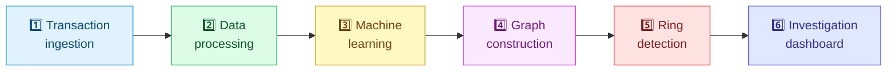

<div align="center">


# 🔍 RingWatch

### Spot the ring. Explain the risk. Empower the investigator.

**An investigator-led, synthetic transaction-risk demo** that scores transactions, groups connected suspicious activity into cases, maps directed money movement between accounts, and explains the evidence behind every review signal.

<br/>


<br/>

> 🕵️ **Supports investigators. It does not block transactions or make final decisions.**
> ⚠️ *Not production banking software.*

</div>

---

## 📑 Table of Contents

- [✨ What the demo includes](#-what-the-demo-includes)
- [🧱 Stack and folder structure](#-stack-and-folder-structure)
- [🚀 Run locally](#-run-locally)
- [📥 CSV format and row accounting](#-csv-format-and-row-accounting)
- [🧪 Sample data](#-sample-data)
- [🔄 Six-stage analysis and features](#-six-stage-analysis-and-features)
- [🚨 Detection rules, model, and risk](#-detection-rules-model-and-risk)
- [🕸️ Graph, rings, cases, and daily budget](#️-graph-rings-cases-and-daily-budget)
- [🔌 API reference](#-api-reference)
- [🧠 In-memory behavior and limitations](#-in-memory-behavior-and-limitations)
- [✅ Tests and acceptance evidence](#-tests-and-acceptance-evidence)
- [🎬 Three-minute demo](#-three-minute-demo)

---

## ✨ What the demo includes

| | Feature |
|---|---|
| 📊 | A deterministic sample of **3,030 transactions** across **200 accounts**: 3,000 normal rows plus **30 planted fraud-pattern rows** |
| 📤 | CSV upload, schema and row validation, rejection/duplicate accounting, and processed/rejected CSV downloads |
| 🔗 | **Six** observable pipeline stages, from transaction ingestion through the investigation dashboard |
| 🧩 | **Six** configurable explainable rules + a fixed-seed **Isolation Forest**, a directed account graph, ring detections, connected cases, and review-budget coverage |
| 🗂️ | Actual paginated/sortable transaction and account feature tables, a keyboard-accessible aggregate-link table, case/account details, and in-memory investigation status actions |
| 📦 | Local frontend libraries: **Chart.js**, **vis-network**, and **Tailwind** assets are bundled in `static/libs/`. No external APIs, no runtime CDN |

---

## 🧱 Stack and folder structure

The Python design is retained: **FastAPI, pandas, NumPy, scikit-learn IsolationForest, NetworkX, Uvicorn, and `python-multipart`**. The frontend is **HTML, CSS, and vanilla JavaScript**. No database or third-party service is used. All thresholds and rule settings are centralized in `config.py`.

```text
main.py                    FastAPI routes and in-memory state
pipeline.py                Ordered six-stage execution and hand-off reports
stage1_ingestion.py         CSV/schema/size/row validation and raw counts
stage2_processing.py        Row dispositions, deduplication and features
rule_engine.py              Six configured, evidence-producing rules
stage3_modeling.py          Isolation Forest and score decomposition
stage4_graph.py             Directed account-pair graph and metrics
stage5_rings.py             Cycles, communities, fan-in and fan-out detections
stage6_investigation.py     Cases, budgets, coverage and status summaries
config.py                   The single source of thresholds, bands and limits
generate_sample.py          Seeded synthetic sample generator
sample_transactions.csv     Deterministic sample download
static/index.html           App shell, Dashboard, Pipeline, Network, Cases, Settings
static/app.js / app.css     Accessible interface and responsive styles
static/libs/                Locally bundled browser libraries
static/favicon.svg          RingWatch favicon
manus-routes.json           Website page-route manifest
requirements.txt            Pinned Python dependencies
Dockerfile                  Production container definition
tests/test_ringwatch.py     Regression and API acceptance-boundary tests
```

---

## 🚀 Run locally

From the project root, install the pinned dependencies and start the app on **port 3000**:

```bash
python -m venv .venv
source .venv/bin/activate       # Windows PowerShell: .venv\Scripts\Activate.ps1
pip install -r requirements.txt
uvicorn main:app --reload --host 127.0.0.1 --port 3000
```

👉 Open **http://127.0.0.1:3000**

| Endpoint | Purpose |
|---|---|
| `GET /healthz` | Unauthenticated readiness endpoint |
| `/` | Root app, favicon, tokens, route manifest, sample CSV and README, all served locally |

🐳 **Docker:** the production Dockerfile installs the pinned requirements, exposes port 3000, and runs Uvicorn on `0.0.0.0`, honoring the hosting platform's `PORT` variable (default 3000). It does **not** enable `--reload` in production.

🎲 Regenerate and overwrite the checked-in deterministic sample CSV:

```bash
python generate_sample.py
```

---

## 📥 CSV format and row accounting

**Required headers (exact):**

```text
txn_id,timestamp,from_account,to_account,amount,channel,city,device_id
```

🏷️ An **optional** `is_fraud` column accepts `0/1` and is used **only** for synthetic coverage/precision evaluation. It is **not** used as a rule, feature, model input, case score, or sorting key. Model and rule results remain unchanged when the label column is changed or omitted.

### ❌ File-level rejection (HTTP 400)

A CSV is rejected if it:

- is empty or cannot be parsed
- is not a `.csv` upload
- lacks required columns (the error names the missing columns)
- exceeds **20 MB**
- has more than **100,000** source rows

A failed upload **does not** replace the currently active dataset.

### 🧹 Row-level rejection (with a reason)

- blank/missing required values
- invalid timestamps
- non-positive amounts
- malformed-width records
- self-transfers
- conflicting reused transaction IDs

Timestamps are parsed as **UTC** and accepted rows are sorted by time.

### 🔁 Duplicates

Exact duplicates compare all eight required-column values: the first row is kept and later exact copies count as *duplicates removed*. If the same transaction ID is reused with different required-column content, the later row is rejected as `conflicting_txn_id`.

The Data Quality view displays received, parsed, accepted, rejected-by-reason, and duplicate counts, and checks:

```text
raw rows = rejected rows + exact duplicates removed + accepted/processed rows
```

Rejected records can be downloaded from the Dashboard. Blank optional-looking fields are still blank *required values* under this CSV contract and are rejected rather than silently imputed.

---

## 🧪 Sample data

`generate_sample.py` uses **seed 42** and creates 3,000 synthetic normal transfers over 200 accounts, then adds **30 `is_fraud=1` rows** in four simplified patterns:

| # | Pattern | Description |
|---|---|---|
| 1️⃣ | **Structuring** | Five near-₹50,000 transfers within two hours |
| 2️⃣ | **Circular flow** | An A→B→C→D→A cycle within 24 hours |
| 3️⃣ | **Fan-in / pass-through** | 12 distinct senders fund a recipient which forwards at least 90% within one hour |
| 4️⃣ | **Odd-hour burst** | Eight around-3AM transfers in under ten minutes on a new city/device |

The generated frame is **identical on every run**. The UI and sample-load response report the number of planted rows. Download the supplied sample with `GET /api/download/sample` or `/sample_transactions.csv`.

---

## 🔄 Six-stage analysis and features



The Pipeline screen and status rail use this exact order. Stage reports include **Not run / Running / Done / Failed** status, elapsed time, input/output counts, hand-off text, and a stage error. Each stage consumes the preceding stage's output. A failure stops later stages; an unsuccessful upload keeps the previous active dataset and is surfaced as the latest attempt.

<details>
<summary><b>📋 Processed transaction table columns</b></summary>

<br/>

Identifiers and UTC time, endpoints and amount, sender-average ratio, 1-hour/24-hour counts, UTC hour, counterparty count, seconds since the prior sender transaction, rule points/reasons, model score, weighted model contribution, final risk, and risk band.

</details>

<details>
<summary><b>👤 Account table columns</b></summary>

<br/>

Transaction count, in/out degrees and totals, average outgoing amount, counterparties, first/last activity, maximum risk, and linked case.

</details>

Dashboard tables are backed by the actual processed rows and support **server-side sorting and pagination**. Use `GET /api/download/processed` for the processed transaction CSV.

---

## 🚨 Detection rules, model, and risk

Rule defaults live in `config.py` and are editable in **Settings**. Each triggered rule contributes its configured points and a plain-English reason with the evidence and threshold.

| # | Rule | Trigger | Points |
|---|---|---|---|
| 1️⃣ | 🧾 **Structuring** | ≥ 3 transfers by one sender within 2 hours; amounts are 90–99% of the illustrative ₹50,000 threshold | **45** |
| 2️⃣ | ⚡ **Velocity** | > 6 transfers by one sender within 10 minutes | **30** |
| 3️⃣ | 🌙 **Odd hour** | 1AM–5AM UTC and amount ≥ 3× the sender's other-transaction average | **25** |
| 4️⃣ | 📱 **New device/city** | First-seen device or city after ≥ 5 earlier sender transactions, with amount above the configurable threshold (default ₹20,000) | **20** |
| 5️⃣ | 🔄 **Circular flow** | Timestamp-valid directed simple cycles of 3–5 accounts within the configured 48-hour window (self-loops and two-cycles excluded) | **50** |
| 6️⃣ | 🌊 **Fan-in / pass-through** | ≥ 8 distinct senders and ≥ 80% of received value forwarded within 1 hour | **50** |

### 🤖 Isolation Forest

Uses **exactly six** transaction inputs:

`amount_vs_account_avg` · `txn_count_1h` · `txn_count_24h` · `hour_of_day` · `distinct_counterparties` · `seconds_since_prev_txn`

- 🌲 **200 estimators**, random seed **42**
- 📏 Anomaly signal is scaled to **0–100 relative to the current dataset**, and is **not a fraud probability**
- 🧮 For fewer than **12 rows**, rule detection still runs and the model contribution is zero

### 🧮 The fixed combined formula

```text
final_risk = min(100, rule_points + 0.4 * ml_score)
```

| Band | Range |
|---|---|
| 🟢 **Low** | < 40 |
| 🟡 **Medium** | 40 – 69 |
| 🔴 **High** | ≥ 70 |

Transactions are flagged at the configurable default threshold **40**. The fixed 0.4 model coefficient is disclosed but is **not** an editable setting. The UI presents worked examples and per-transaction score components. Robust feature deviations are descriptive signals, not causal IsolationForest attributions.

---

## 🕸️ Graph, rings, cases, and daily budget

### 🌐 Graph

- **Nodes** represent accounts; **directed edges** aggregate each ordered account pair and include transaction count, total amount, first/last timestamps, risk, case and ring IDs
- 🔵 Node **size** = transaction volume · 🎨 node **color** = risk · ➡️ arrows show direction · 🔴 circular-flow edges are **red**
- Network view provides search, flagged-only and minimum-risk filters, zoom/pan, focus controls, and an accessible equivalent link table
- Ring rows can focus/highlight associated graph activity and linked cases

### 💍 Ring detectors

Timestamp-valid **cycles**, deterministic **Louvain dense communities**, **fan-in cohorts**, and **fan-out hubs**. Community/hub detections are heuristic demo signals, not calibrated fraud classifications.

### 📁 Cases

Flagged transactions are grouped by **weakly connected components** of the flagged-transaction graph into cases.

- 🏆 **Case score** = highest account risk
- 💰 **Case value** = sum of its flagged transfer amounts
- 📝 **Status** is held in memory: `confirmed`, `false_positive`, or `escalated`
- 🔎 Case detail includes evidence, a transaction timeline and the decomposition `rule_points + 0.4 × ml_score → capped final_risk`

### 🎚️ Daily alert budget

The slider spans **1 through the total number of cases** and selects the top-N score-ranked cases.

| Mode | Coverage | Precision | False alarms |
|---|---|---|---|
| 🏷️ **With `is_fraud`** | Share of labeled fraud **value** in reviewed cases | Share of reviewed cases containing at least one labeled fraud | Remaining reviewed cases |
| 🚫 **Without labels** | Share of total flagged case-risk **score** covered (*not* fraud caught) | n/a | n/a |

The coverage curve includes every integer budget through the total cases and uses a random-review baseline.

---

## 🔌 API reference

> Data-dependent endpoints return **HTTP 409** with a clear no-dataset message until sample data or an upload is loaded.

| Method and path | Behavior |
|---|---|
| `GET /api/sample?budget=N` | Generate and run the deterministic built-in sample |
| `POST /api/upload?budget=N` | Upload multipart CSV using form field `file`; invalid file-level input returns HTTP 400 |
| `GET /api/status` | Active dataset, summary, and latest attempt/status |
| `GET /api/pipeline` | Six stage reports, hand-offs, model facts, previews, rings and case summary |
| `GET /api/features?kind=transactions\|accounts&offset=0&limit=20&sort_by=final_risk&direction=desc` | Actual paginated feature rows; label sort keys are rejected |
| `GET /api/cases?budget=N` | Ranked cases, selected cases, coverage values and complete coverage curve |
| `GET /api/graph` | Account nodes, directed aggregated links, graph metrics and ring associations |
| `GET /api/account/{account_id}` | Account risk/reasons and bounded transaction detail |
| `GET /api/case/{id}` | Case score, reasons, score breakdown, transactions and linked graph evidence |
| `POST` or `PUT /api/case/{id}/status` | JSON body `{"status":"confirmed"}`, `false_positive`, or `escalated` |
| `GET /api/config`, `PUT /api/config` | Read or update threshold settings with JSON body `{"settings":{"flagged_risk_threshold":40}}` (`/api/settings` is a compatible alias) |
| `POST /api/detect?budget=N` | Rerun current in-memory data with current settings |
| `GET /api/download/sample\|processed\|rejected` | Download sample, accepted processed transactions, or row-level rejections as CSV |
| `DELETE /api/data` | Clear dataset, statuses, results and stage state; Settings are preserved (`POST /api/clear` is an alias) |

### 💻 Try it

```bash
curl -s http://127.0.0.1:3000/api/status
curl -s 'http://127.0.0.1:3000/api/sample?budget=10'
curl -s -F 'file=@sample_transactions.csv' 'http://127.0.0.1:3000/api/upload?budget=10'
curl -s 'http://127.0.0.1:3000/api/cases?budget=5'
curl -s 'http://127.0.0.1:3000/api/features?kind=transactions&offset=0&limit=5&sort_by=final_risk&direction=desc'
curl -s -X PUT -H 'Content-Type: application/json' -d '{"settings":{"flagged_risk_threshold":40}}' http://127.0.0.1:3000/api/config
curl -s -X DELETE http://127.0.0.1:3000/api/data
```

The in-app **Settings** page includes the API reference and links to this README. `GET /manus-routes.json` returns the website page manifest; `GET /healthz` is the public readiness endpoint.

---

## 🧠 In-memory behavior and limitations

> [!WARNING]
> Uploaded transactions, generated results, cases, settings, and investigation statuses are **process-local**. There is no database or durable upload storage. A process restart/redeploy **loses active data**.

- 🧹 **Clear data** removes the active dataset, statuses and results while retaining Settings
- 🎓 This is a **synthetic hackathon demo**: sample patterns are simplified, thresholds are examples, and the model has **not** been validated on real bank data
- 📐 Anomaly scores are relative to the active dataset
- 🤝 RingWatch **supports investigators**; it does not block transactions or make final decisions

---

## ✅ Tests and acceptance evidence

```bash
python -m pytest -q
```


<details>
<summary><b>🔬 What the tests cover</b></summary>

<br/>

- Deterministic sample size and checked-in CSV consistency
- All six positive rules and near-miss cases
- File and row rejection boundaries
- Duplicate/conflicting-ID accounting
- The exact six-feature / fixed-seed model contract
- Formula/capping examples
- Label flip/removal invariance
- Case grouping, graph/ring evidence
- Coverage with and without labels
- Endpoint contracts (including POST/PUT status aliases)
- Feature-label isolation
- Upload preservation
- CSV downloads and Clear data behavior
- Exact-stage failure stopping

</details>

One third-party Starlette/AnyIO deprecation warning is non-fatal. Browser/offline/restart/deployment checks are recorded separately in `ACCEPTANCE_REPORT.md`. Do **not** interpret backend tests as real-bank validation.

---

## 🎬 Three-minute demo

1. 📥 **Load the sample** and call out the exact **3,030 rows** and **30 planted fraud-pattern rows**
2. 🧾 Show the **Data Quality** reconciliation and the flagged-transactions-to-connected-cases KPI
3. 🔄 Open **Pipeline** to explain the six hand-offs, six model inputs and the live `rule_points + 0.4 × ml_score` example
4. 🎚️ Move the **daily review-budget slider** and compare its coverage curve; note whether the metric is labeled fraud value or unlabeled risk-score coverage
5. 🕸️ Open **Network**, focus the red cycle/ring and inspect its linked case; read the plain-English evidence and transaction score breakdown
6. ✅ Use a **case status action**, then finish on **Settings** and the separate **Assumptions and limitations** screen

---

<div align="center">

**🔍 RingWatch** · Synthetic data only · Built for investigators, not for blocking decisions

</div>
